# PagePoster Desktop
Гайд користувача українською · 25 листопада 2026 · версія 1.1

## 1. Перед першим запуском
Цей гайд проведе вас від налаштування до публікації та ручної перевірки сторінок. Для першої вправи використайте готовий навчальний HTML-проєкт.

**Підготуйте заздалегідь**
- Комп’ютер із Windows, доступ до інтернету та встановлений Google Chrome.
- Розпаковану папку PagePoster. Запускайте **PagePoster.exe** з цієї папки.
- Свій робочий **OpenAI API-ключ** і доступний ліміт для запитів. Пароль від ChatGPT не замінює API-ключ.
- Google-акаунт із доступом на читання до бази сайтів.
- Матеріали проєкту й доступ до WordPress на сайтах, де ви будете публікувати.

**Як рухатися гайдом**
Налаштування: розділи 3–6. Імпорт і матеріали: 7–12. Публікація та рішення: 13–17. Експорт, копія й додаткові режими: 18–21.

| Термін | Простими словами |
| --- | --- |
| API-ключ | Ключ доступу PagePoster до вашого OpenAI API-проєкту. |
| Проєкт | Група сторінок одного завдання. |
| Донор | Сайт WordPress, на якому створюється сторінка. |
| HTML | Готовий код сторінки з її оформленням. |
| Анкор | Точний текст посилання, наприклад travel guide. |
| Slug / слаг | Частина адреси сторінки після домену: my-guide. |
| GEO | Країна для підбору сайту: UA, GB, NZ. |
| DR / трафік | Показники сайту з вашої бази, які можна використати як фільтри. |

> **Про ілюстрації.** Усі скріншоти зроблено в українському PagePoster з навчальними даними. Домени example, показники та стани публікації наведено для пояснення інтерфейсу. Це не звіт про реальні розміщення.

## 2. Знайомство з робочим місцем
Ліва панель дає доступ до сторінок, імпорту, списку проєктів і налаштувань. Після імпорту основна робота відбувається в таблиці.

1. **Налаштування** внизу ліворуч: ключ OpenAI, Google, проксі та резервні копії.
2. **Імпорт проєкту**: завантаження нових матеріалів.
3. **Сторінки й черги**: стан підготовки, донори, запуск публікації та перевірка результатів.
4. Фільтри **Проєкт**, **Пошук**, **Стан**, **Мова**, **Гео** допомагають знайти потрібні рядки. **Скинути** повертає повний список.

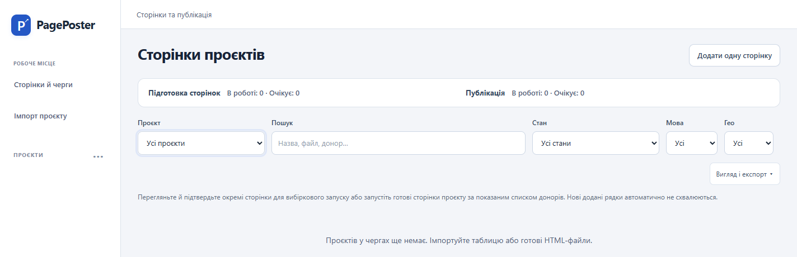

> **Після запуску:** має відкритися вікно PagePoster. Порожній список на новому комп’ютері нормальний: спочатку підключіть сервіси та імпортуйте матеріали.

## 3. Підключіть OpenAI
Починайте налаштування з ключа OpenAI. Він використовується для генерації та розпізнавання нестандартних завдань. Якщо працюєте з командним акаунтом, отримайте API-ключ у відповідального за нього.

1. Відкрийте **Налаштування → OpenAI**.
2. Розгорніть **Додати або змінити ключ OpenAI**.
3. Вставте свій API-ключ у поле **Ключ API**.
4. Натисніть **Зберегти ключ OpenAI**.
5. Натисніть **Перевірити доступ до моделі** та прочитайте повідомлення.

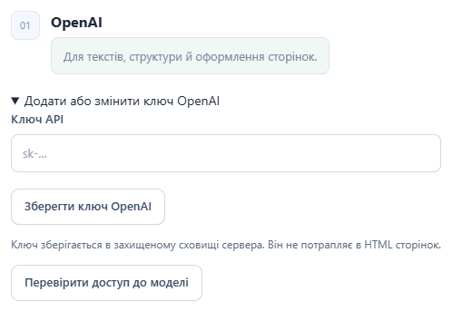

> **Після налаштування:** PagePoster показує, що ключ збережено. Збережений ключ ще не гарантує доступний баланс: можливість виконати генерацію перевіряється під час запиту.

Якщо з’явилася помилка, перевірте чинність ключа, дозволи API-проєкту та доступний ліміт у своєму OpenAI-акаунті. Після виправлення продовжуйте збережений запуск.

## 4. Укажіть базу сайтів
База сайтів — Google Таблиця з доменами, доступами WordPress і показниками донорів. Якщо бази ще немає, у комплекті прикладів є **03-donor-base-template.csv**: розпакуйте архів прикладів, імпортуйте цей CSV у Google Таблиці та замініть навчальні дані своїми.

1. Відкрийте потрібну таблицю в браузері й виберіть саме ту вкладку, де розташована база.
2. Скопіюйте повну адресу з адресного рядка.
3. У PagePoster відкрийте **Налаштування → Google і таблиця**.
4. Вставте адресу в поле **Повне посилання на потрібну вкладку Google Таблиці**.

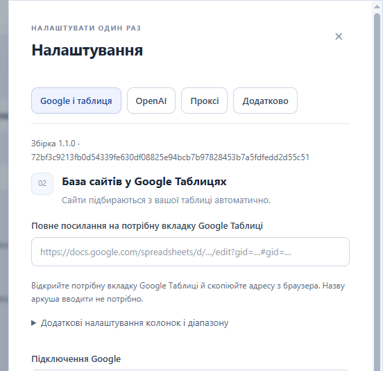

> **Перевірте:** посилання веде на правильну вкладку. Частина gid в адресі допомагає PagePoster вибрати її. Назву аркуша окремо вводити не потрібно.

Мова майбутньої сторінки й GEO донора — різні налаштування. Наприклад, англомовна сторінка може потребувати сайту з GEO NZ.

## 5. Увійдіть через Google і перевірте читання
Той самий акаунт, який ви оберете під час входу, повинен мати доступ до бази.

**Перший запуск, якщо програма просить реєстрацію Google.** Отримайте у відповідального за PagePoster або адміністратора Google Cloud JSON-файл OAuth-клієнта типу **Desktop app**. У **Налаштування → Google і таблиця** виберіть його в полі **JSON-файл реєстрації Google** та натисніть **Імпортувати реєстрацію**. Після цього стане доступною кнопка входу. Якщо реєстрацію вже налаштовано, одразу переходьте до входу.

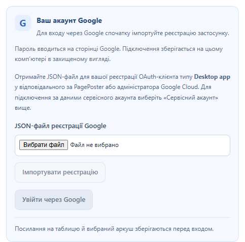

1. У полі **Підключення Google** залиште **Мій акаунт — увійти через Google**.
2. Натисніть **Увійти через Google**.
3. У вікні Chrome виберіть потрібний акаунт і підтвердьте запит доступу.
4. Поверніться в PagePoster. Програма перевіряє вибрану вкладку після підключення.
5. Натисніть **Зберегти налаштування бази**, а потім **Перевірити підбір**, якщо потрібна повторна перевірка.

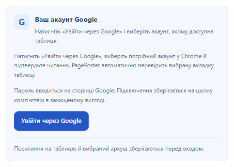

> **Успішний результат:** видно підключений акаунт і результат читання таблиці з кількістю придатних сайтів. Нуль придатних сайтів може означати надто суворі фільтри або відсутність доступних донорів, а не помилку входу.

Якщо ваша команда використовує сервісний акаунт, виберіть **Сервісний акаунт**, вставте наданий для нього JSON і надайте таблиці доступ на читання для адреси з поля client_email.

## 6. Звірте колонки бази сайтів
Відкрийте **Додаткові налаштування колонок і діапазону**, якщо ваша таблиця відрізняється від збереженої схеми.

| Поле PagePoster | Типова колонка |
| --- | --- |
| Домен | B |
| DR / трафік / гео | D / E / F |
| Перший логін / пароль | K / L |
| Другий логін / пароль | N / O |
| Рядків заголовка | 1, якщо зверху один рядок назв |

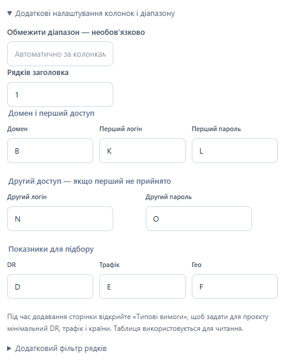

Для першого сайту заповніть **B2** його доменом, **K2** логіном, **L2** паролем WordPress. У першому рядку залиште заголовки. DR, трафік і GEO заповніть у відповідних колонках, якщо ці дані є.

1. Якщо значення розташоване в іншій колонці, укажіть її літеру.
2. Колонки другого доступу заповнюйте, якщо він є у вашій базі.
3. Після змін натисніть **Зберегти налаштування бази → Перевірити підбір**.

> **Важливо:** кольори клітинок не є дозволом на публікацію. Для окремого фільтра використовується налаштована колонка **Дозволено** зі значеннями на кшталт 1/0 або yes/no.

## 7. Завантажте проєкт одним файлом
Для звичайного імпорту не потрібно вибирати тип джерела вручну.

1. У лівій панелі натисніть **Імпорт проєкту**.
2. У полі **Завантажити проєкт** натисніть **Вибрати файл**.
3. Виберіть таблицю, документ, HTML або архів і дочекайтеся завершення читання.
4. PagePoster визначить підтримуваний формат, додасть сторінки й почне їх підготовку.
5. Звірте назву проєкту та кількість доданих сторінок у таблиці.

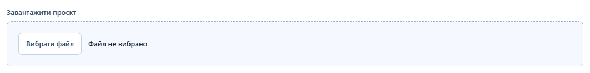

Підтримуються CSV, TSV, XLSX, TXT, Markdown, DOCX, HTML, ZIP і RAR. Для незвичного формату збережіть дані в один із підтримуваних форматів.

- **XLSX.** PagePoster збирає завдання з видимих аркушів, якщо знаходить відомі заголовки серед перших 20 заповнених рядків. Для формул читаються лише безпечні прості значення, вже збережені у файлі. Якщо формула заважає імпорту, збережіть потрібні клітинки як звичайні значення та повторіть читання файлу.
- **ZIP і RAR.** Один архів може містити кілька сумісних таблиць. Використовуйте повні шляхи всередині архіву в колонці **file**, наприклад pages/ua-guide.html. PagePoster зберігає відомості про вихідний файл, аркуш і рядок, коли ці дані доступні. Розгорніть відомості під назвою сторінки, щоб перевірити джерело.

> **Не плутайте етапи:** імпорт починає підготовку матеріалів. Публікацію на сайтах запускають окремою кнопкою. AI-підготовка використовує підключений OpenAI API.

**Ручний імпорт і Google Drive** потрібен для додаткових сценаріїв. У ньому спочатку виконують **Перевірити рядки**, потім **Додати до черги**.

Для готового HTML можна вибрати джерело **Google Drive: файл або тека**. Програма читає HTML у вкладених теках і пропускає сторонні файли, зокрема примітки. Якщо вкладеність більша за вісім рівнів, виберіть ближчу теку або підготуйте архів. Якщо HTML залежить від сусідніх файлів CSS, зображень або шрифтів, завантажте локальний ZIP або RAR з усіма ресурсами через **Імпорт проєкту**.

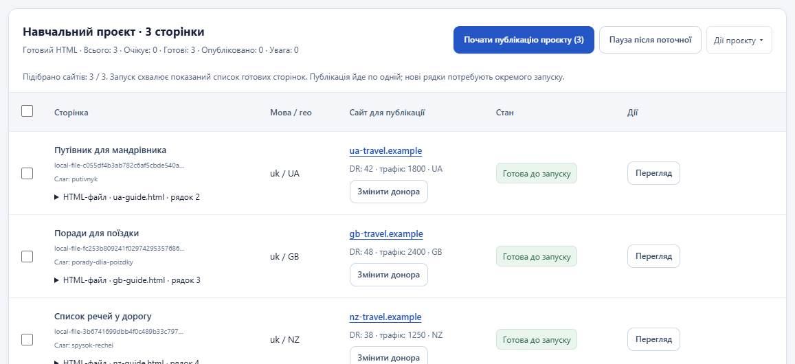

## 8. Навчальний приклад і потрібні дані
Разом із гайдом підготовлено архів **PagePoster-Guide-Examples.zip**. Спочатку розпакуйте його.

**Варіант А — готовий HTML**
Завантажте вкладений **02-html-project.zip** через **Імпорт проєкту**. Він містить три сторінки та таблицю plan.csv. Очікуйте три рядки з назвами українською.

~~~text
02-html-project.zip
  plan.csv
  pages/ua-guide.html
  pages/gb-guide.html
  pages/nz-guide.html
~~~

Приклад рядка plan.csv:

~~~csv
file,slug,language,geo
pages/ua-guide.html,putivnyk,uk,UA
~~~

**Окремо — шаблон бази**
Файл **03-donor-base-template.csv** призначений для Google Таблиць, а не для імпорту сторінок у PagePoster. Як підключити цю базу, описано в розділах 4–6.

**Варіант Б — генерація**
Файл **01-ai-project.csv** містить одне завдання англійською з двома парами посилань і чотирма картками. Після імпорту PagePoster запускає його AI-підготовку. Перед реальним використанням замініть навчальні адреси своїми.

Для окремої сторінки виберіть проєкт для генерації, натисніть **Додати одну сторінку** та виберіть **ШІ за посиланнями й анкорами**. У полі **Мова сторінки** є 22 мови, зокрема українська, грецька та гінді. Введіть пари URL і анкорів і за потреби заповніть **Кількість карток**.

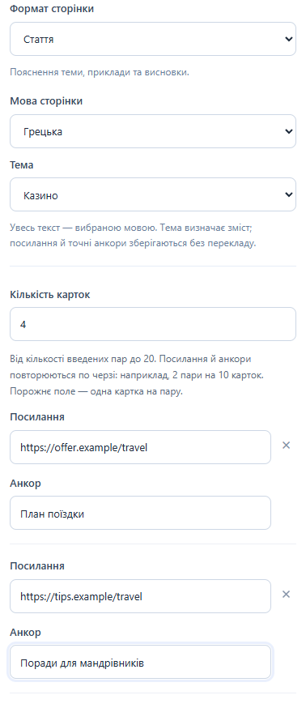

Кількість карток може бути від 1 до 20 і має бути щонайменше такою, як кількість пар. Якщо ввести 4 картки для двох пар, програма розподілить їх у порядку 1, 2, 1, 2. Якщо поле порожнє, буде по одній картці на пару. Для CSV використовуйте колонку **cardCount**.

| Поле | Що означає |
| --- | --- |
| url / anchor | Точна адреса посилання та його текст. |
| file | Який HTML-файл відповідає рядку. |
| slug | Бажана частина адреси нової сторінки. |
| donor | Конкретний сайт для розміщення, якщо він заданий у ТЗ. |
| language / geo | Мова сторінки та країна донора. |
| cardCount | Бажана кількість карток для генерації. |

> **Для першої вправи:** почніть із HTML ZIP, перевірте три рядки й призначте власний тестовий сайт перед публікацією. У прикладі донорів не задано. Домени example не є робочими посиланнями.

## 9. Звірте сторінки та вимоги
У **Сторінки й черги** відкрийте свій проєкт. Перевірте назви, мову, GEO, слаг і вихідні файли. Відомості про файл розгортаються під назвою сторінки.

1. До запуску WordPress відкрийте **Дії проєкту → Змінити мову / GEO / DR / трафік**.
2. Позначте лише ті показники, які хочете змінити, і заповніть поля.
3. Натисніть **Застосувати й підібрати заново**.
4. Перевірте новий список донорів. Для вибраних рядків доступна окрема кнопка **DR / трафік** над таблицею.

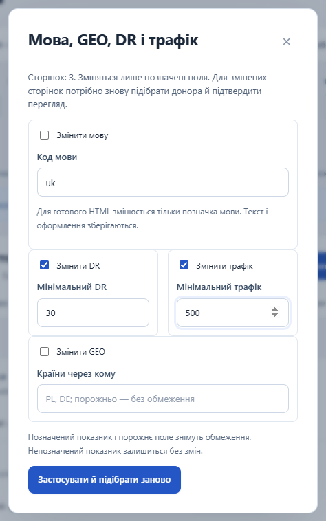

> **Правило полів:** непозначений показник залишається без змін. Позначений показник із порожнім полем знімає обмеження. Зміна коду мови для готового HTML не перекладає його текст.

Якщо дія недоступна, перевірте поточний стан рядка й донора. Сторінка, для якої вже почалася робота WordPress, може бути заблокована для такого редагування.

## 10. Перевірте підібраних донорів
Донор — сайт, де PagePoster створить сторінку. У таблиці він показаний у колонці **Сайт для публікації** разом із відомими показниками.

1. Натисніть **Вибрати донора** або **Змінити донора** в рядку сторінки.
2. На вкладці **З бази сайтів** знайдіть потрібний домен і звірте DR, трафік та GEO.
3. Натисніть **Обрати** біля доступного сайту.
4. Переконайтеся, що цей домен з’явився в рядку сторінки.

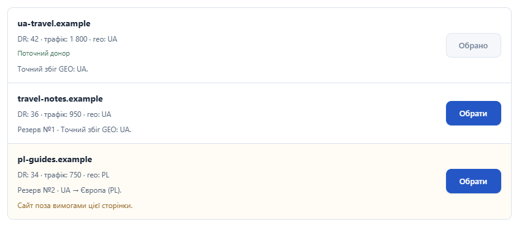

> **Орієнтири:** «—» означає відсутність показника. Біля недоступного донора є пояснення. **Показати також сайти поза вимогами сторінки** розширює лише ручний список — звіряйте такий вибір із вимогами завдання.

У ручному списку PagePoster пояснює, чи знайдено точний збіг GEO, країну з близької локалі або інше GEO. Позначки **Рекомендований варіант** і **Резерв №1**, **Резерв №2** допомагають переглядати доступні варіанти по порядку. Для автоматичного підбору діють задані вимоги сторінки.

Кнопка **Оновити** перечитує список. Якщо донорів немає, перевірте GEO та мінімальні показники, доступність сайтів і результат читання бази.

Для підбору GEO використовуйте дволітерні коди країн, наприклад **UA**, **PL** або **GB**. Код **UK** для Великої Британії PagePoster читає як **GB**. Під час підбору піддомени одного зареєстрованого домену, наприклад news.travel.example та blog.travel.example, вважаються одним донором. Окремі сайти на WordPress.com враховуються окремо.

## 11. Як указати сайт вручну
Цей варіант підходить, коли потрібно розмістити конкретну сторінку на конкретному сайті.

1. Відкрийте вибір донора й вкладку **Вручну**.
2. Укажіть **Адреса WordPress**: домен або повну адресу сайту.
3. Введіть **Логін адміністратора** та **Пароль WordPress**.
4. Натисніть **Зберегти сайт**.
5. Звірте домен у рядку сторінки.

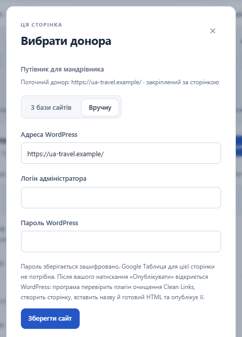

> **Після збереження:** сайт призначено цій сторінці. Це ще не публікація. Для входу й розміщення потрібен окремий запуск публікації.

Використовуйте доступ, який дозволяє створювати сторінки WordPress. Якщо є лише обмежені права, частина дій, зокрема встановлення плагінів, може бути недоступною.

## 12. Перегляньте готовий матеріал
У рядку сторінки натисніть **Перегляд**. Зверху видно контекст сторінки, а в центрі — підготовлений HTML.

1. Звірте текст, назву, анкори та адреси посилань із завданням.
2. Перевірте оформлення, кнопки та меню. У **Вигляд** перемкніть комп’ютер і телефон.
3. Якщо публікуватимете вибрані рядки, натисніть **Я переглянув цю сторінку**. **Переглянув → далі** відкриває наступну.
4. Закрийте перегляд хрестиком або Escape, щоб повернутися до списку.

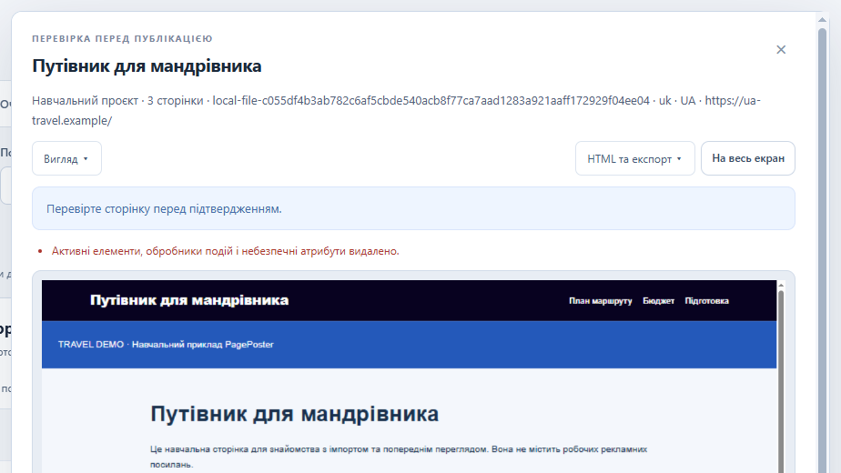

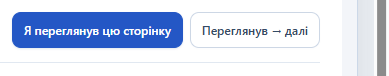

Якщо PagePoster показує попередження про очищення HTML, він змінив певні елементи коду. Перед підтвердженням перевірте, що оформлення та цільові посилання залишилися правильними.

> **Перевірте:** на телефоні немає зайвого горизонтального прокручування; текст і кнопки читаються; меню працює. Попередній перегляд показує підготовлений матеріал, а остаточний вигляд на сайті перевіряють після публікації.

## 13. Запустіть публікацію
Перед запуском у потрібних рядках мають бути готові матеріали та підібрані сайти.

**Увесь готовий проєкт**
Скиньте фільтри та натисніть **Почати публікацію проєкту**. Число на кнопці показує, скільки сторінок увійде в запуск.

**Лише окремі сторінки**
Позначте рядки галочками. Для кожного відкрийте **Перегляд → Я переглянув цю сторінку**, потім натисніть **Опублікувати вибрані** над таблицею.

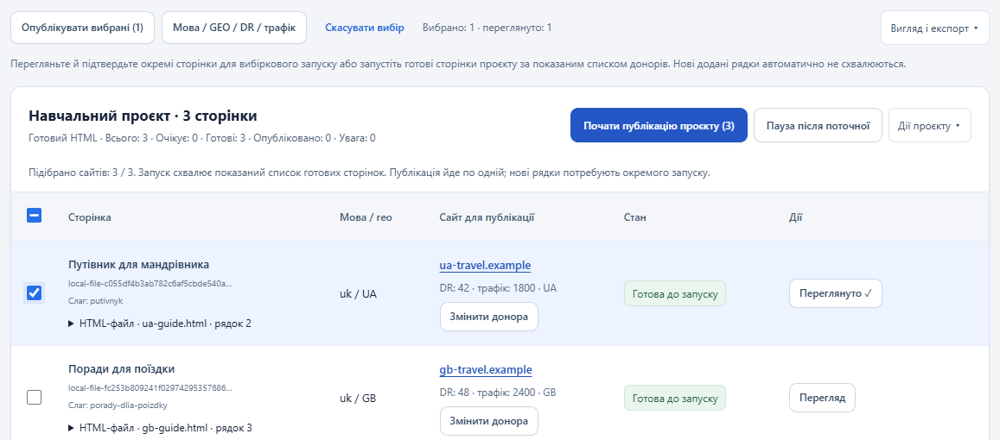

> **Саме тут починається реальне розміщення.** Звірте проєкт, сторінки й домени перед натисканням. Нові рядки, додані пізніше, потребують окремого запуску.

Якщо кнопка сіра, перевірте готовність матеріалу, донора, фільтри й паузу. Для вибіркового запуску також перевірте, чи підтверджено перегляд.

## 14. Стежте за чергою
PagePoster працює зі сторінками по черзі. Верхні лічильники відокремлюють **Підготовка сторінок** від **Публікація**.

1. Під час розміщення браузер WordPress виконує вхід і створення сторінки.
2. Якщо сайт попросив CAPTCHA чи додаткове підтвердження, виконайте його у відкритому вікні.
3. Якщо донор не підходить, читайте причину пропуску біля сторінки. Автопідбір може перейти до наступного донора.
4. Коли з’явиться **Опубліковано · очікує перегляду**, переходьте до ручної перевірки.

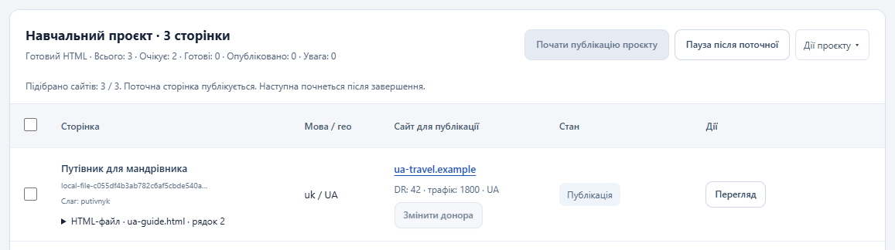

> **Як зробити перерву:** натисніть **Пауза після поточної** та дочекайтеся завершення вже розпочатої дії. **Продовжити проєкт** відновлює чергу. Закриття вікна хрестиком завершує роботу PagePoster.

Якщо рядок має статус, що потребує дії, розгорніть його пояснення. Продовжуйте з наявного рядка, щоб зберегти зв’язок із уже створеною чернеткою або сторінкою.

**Як відкласти один рядок.** Якщо біля заблокованої сторінки доступна дія **Відкласти й продовжити чергу**, натисніть її. PagePoster закриє поточну сесію WordPress і дасть черзі перейти до інших завдань. Сторінка збереже свого донора й ідентифікатор WordPress, якщо його вже отримано. Щоб повернутися до цього рядка, натисніть **Продовжити відкладену сторінку**. Це окрема ручна дія навіть після перезапуску програми.

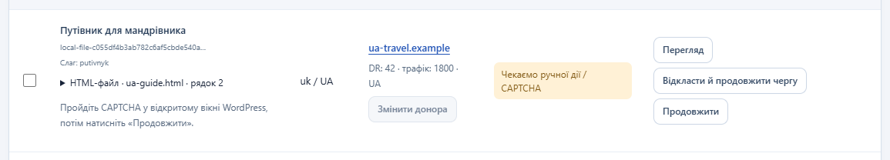

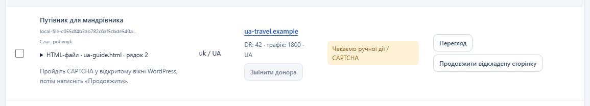

Якщо WordPress показує CAPTCHA або просить увійти, виконайте потрібну дію вручну у відкритому браузері та продовжте з цього самого рядка.

## 15. Перевірте живу сторінку
Після публікації потрібно перевірити саме сторінку на сайті. У **Сторінки й черги** знайти такі рядки допоможе фільтр **Стан → Опубліковані**.

1. У рядку натисніть **Перевірити сторінку**.
2. У браузері відкриється жива сторінка, а в PagePoster — вікно **Ручна перевірка**.
3. Звірте назву, текст, зображення, кнопки, посилання та вигляд на телефоні. Переконайтеся, що оформлення сайту не перекриває матеріал.
4. Для перевірки на телефоні відкрийте цей самий URL у мобільному браузері.
5. Поверніться в PagePoster та натисніть **Схвалити**, якщо результат підходить.

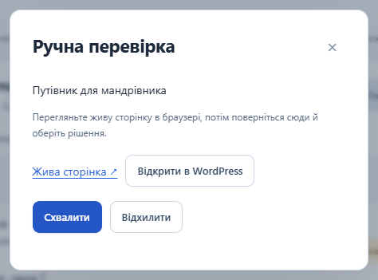

> **Після схвалення:** стан стає **Опубліковано · схвалено**. Це ваша оцінка вже опублікованого результату; сторінка повторно не створюється.

**Жива сторінка** відкриває результат повторно. **Відкрити в WordPress** запускає вхід у редактор саме цієї сторінки, якщо для неї доступний збережений вхід.

## 16. Відхиліть сторінку та дочекайтеся кошика
Якщо результат не підходить, PagePoster може перенести сторінку в кошик WordPress за вашим рішенням.

1. Відкрийте **Перевірити сторінку** та натисніть **Відхилити**.
2. З’явиться **Перенесення в кошик**. Дочекайтеся завершення.
3. Лише **У кошику WordPress** підтверджує, що дію завершено.

Нижче показано два фінальні стани: схвалення та підтверджений кошик.

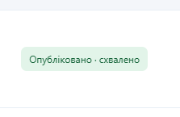

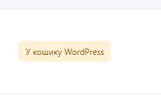

За стану **Кошик · потрібне звірення** натисніть **Звірити кошик** у рядку та підтвердьте звірення однойменною кнопкою у вікні **Ручна перевірка**. Ця дія перевіряє стан сторінки у WordPress.

Якщо WordPress підтвердить, що сторінка досі опублікована без змін, з’явиться стан **Не вдалося перенести в кошик** із повідомленням про повторне відхилення. Відкрийте **Перевірити сторінку** ще раз, звірте живий результат і, якщо рішення лишилося тим самим, натисніть **Відхилити** в новому вікні перевірки. Програма автоматично прив’язує рішення до актуального стану. Якщо відкрите вікно застаріло, закрийте його й відкрийте перевірку заново.

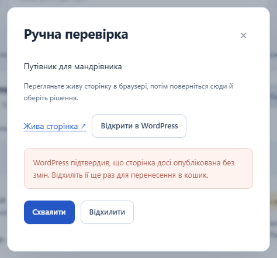

Якщо сторінка змінилася або її стан досі невідомий, прочитайте пояснення в рядку та скористайтеся **Відкрити в WordPress**, якщо ця дія доступна.

Кошик WordPress стосується опублікованої сторінки на сайті. Видалення або закриття проєкту в PagePoster — інша дія; воно не означає видалення публікацій із WordPress.

## 17. Якщо щось не працює
Спочатку прочитайте повідомлення біля конкретної сторінки та розгорніть **Діагностика публікації**, якщо вона доступна.

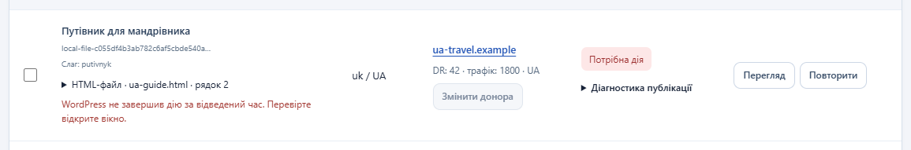

| Що бачите | Що робити |
| --- | --- |
| OpenAI не приймає ключ або відмовляє в доступі | Перевірте ключ, права API-проєкту й ліміт. Після виправлення продовжте збережений запуск. |
| Google не читає таблицю | Якщо програма просить реєстрацію, виконайте налаштування з розділу 5. Перевірте повне посилання, вкладку та доступ вибраного акаунта. Повторіть вхід і перевірку підбору. |
| Немає придатних донорів | Перевірте GEO, мінімальні DR/трафік, колонки й доступність сайтів. |
| BROWSER_TIMEOUT або незрозумілий результат WordPress | Перевірте відкрите вікно й діагностику. Використайте доступне «Повторити» чи звірку стану в цьому самому рядку. |
| Публікація не завершена, є CAPTCHA | Завершіть потрібну дію у відкритому браузері й продовжте поточний запуск. |
| Імпорт відхилено | Виправте вказаний рядок або формат. Якщо перевищено розмір, розділіть проєкт на менші файли. |

> **Не починайте повторний імпорт лише через затримку.** Спочатку перевірте поточний рядок: у WordPress уже могла зберегтися чернетка або сторінка.

## 18. Експортуйте результати
Меню **Вигляд і експорт** розташоване над таблицею. Фільтри та вибір рядків впливають на те, які матеріали ви бачите.

1. **Експорт списку CSV** зберігає список сторінок і дані про них. Це зручно для звіту.
2. **ZIP готових HTML** зберігає підготовлені сторінки файлами.
3. Якщо рядки вибрані, ZIP містить вибрані готові матеріали. Без вибору — усі видимі готові матеріали.
4. **Оновити зараз** перечитує поточні стани; налаштування рядків змінює щільність таблиці.

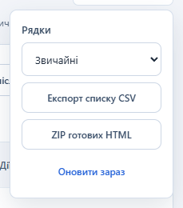

> **Окремий HTML:** у **Перегляд → HTML та експорт** доступні **Копіювати HTML**, **Завантажити HTML** та **Ручне розміщення**. CSV зі списком не є повною резервною копією програми.

Для замовника зручно експортувати список після ручної перевірки, коли для сторінок уже є остаточні рішення.

## 19. Збережіть резервну копію
Повна копія потрібна для збереження робочого стану або перенесення на інший комп’ютер.

1. Відкрийте **Налаштування → Додатково → Керування резервними копіями**.
2. У розділі **Зберегти копію** задайте пароль щонайменше з 12 символів.
3. Натисніть **Створити й завантажити копію** та збережіть файл.
4. Збережіть пароль окремо: він потрібний для відновлення.

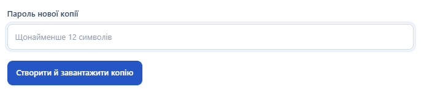

**Відновлення**
У порожній базі відкрийте **Відновити з файлу**, виберіть копію, введіть пароль і натисніть **Перевірити файл**. Звірте вміст, підтвердьте відновлення та виконайте його. Потім перезапустіть PagePoster.

> **Після відновлення:** перевірте проєкти та підключення. Завдання залишаються призупиненими до вашого ручного продовження. Наявну заповнену базу цей сценарій не перезаписує.

## 20. Проксі — якщо потрібні для роботи
Для першого знайомства не змінюйте цей розділ, якщо проксі вам не потрібні.

1. Відкрийте **Налаштування → Проксі**.
2. Увімкніть використання проксі та вставте список у вказаному в інтерфейсі форматі, по одному на рядок.
3. Натисніть **Зберегти проксі**, потім **Перевірити проксі**.
4. Звірте результати доступності, IP та країни, якщо їх визначено.

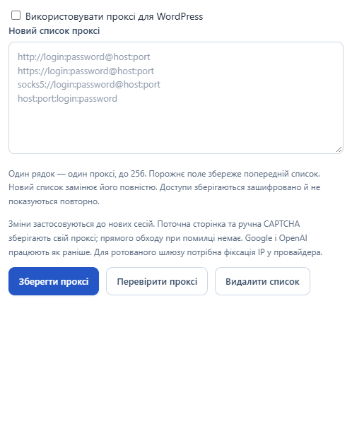

> **Як застосовується:** зміни діють для нових сесій WordPress. Поточна сторінка зберігає свій проксі. Зелений результат перевірки проксі не гарантує доступ до кожного окремого сайту.

Виміряний обсяг можна переглянути через **Дії проєкту → Трафік проксі**. Він не замінює рахунок провайдера.

## 21. Інші дії та завершення роботи
Додаткові функції потрібні за окремим завданням; звичайний цикл роботи вже пройдено.

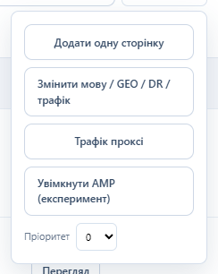

- **AMP.** Режим вмикається через **Дії проєкту → Увімкнути AMP (експеримент)** до публікації. Для роботи потрібна підтримка Clean Links 1.2.1 на сайті. Зворотна дія — **Вимкнути AMP (експеримент)**. Зміна режиму проєкту не переписує вже опубліковані сторінки.
- **Заміна посилань.** У рядку опублікованої сторінки є **Замінити посилання**, якщо ця дія доступна для її стану. Перед підтвердженням звірте запропоновані зміни.
- **Закриті проєкти та кошик.** Кнопка **⋯** біля заголовка **ПРОЄКТИ** відкриває керування проєктами. Це впорядкування списку в PagePoster.
- **Допомога.** У **Налаштування → Додатково → Діагностика для підтримки** можна завантажити звіт підтримки.

> **Роботу з проєктом завершено, коли:** усі потрібні сторінки мають результат публікації; ви відкрили живі сторінки та прийняли рішення; для відхилених підтверджено кошик; список результатів збережено.

Перед закриттям програми поставте потрібну чергу на паузу й дочекайтеся поточної дії. Після цього закрийте вікно хрестиком.
